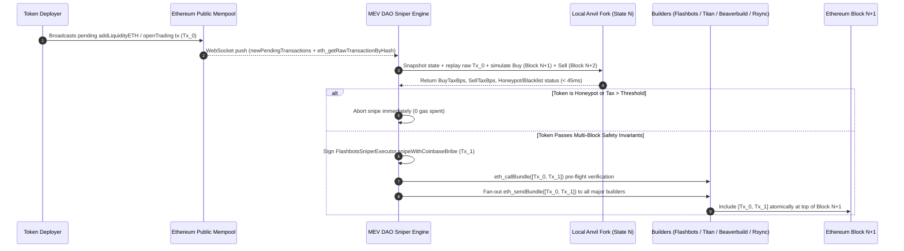

# Ethereum Sniper Bot (Flashbots Block-0 Uniswap V2/V3 Mempool Sniper)

**TL;DR:** An **Ethereum sniper bot** is an automated execution engine that monitors the Ethereum public mempool for pending token liquidity events (`addLiquidityETH`, `openTrading`, `enableTrading`), simulates the token's buy/sell taxes and transfer hooks on a local Anvil mainnet fork in under 50 milliseconds, and submits an atomic two-transaction bundle (`[devLiquidityTx, sniperBuyTx]`) via `eth_sendBundle` directly to Ethereum block builders (`relay.flashbots.net`, Titan, Beaverbuild, Rsync). Because Flashbots bundles execute atomically or drop entirely without landing on-chain, a properly architected **Flashbots sniper bot** never pays gas for reverted transactions or missed block-0 entries. This open-source TypeScript (`viem`) + Solidity reference repository is maintained by **[MEV DAO](https://mevdao.org)** alongside our production deep-dive on **[Ethereum Sniper Bot: Flashbots Same-Block Sniping on Uniswap](https://mevdao.org/blog/ethereum-sniper-bot-flashbots-same-block-sniping-on-uniswap)**.

[](./LICENSE)
[](https://mevdao.org)
[](https://www.typescriptlang.org/)
[](https://soliditylang.org/)

---

## Quick Links & Production Documentation

- **Live Infrastructure & Managed Block-0 Execution:** **[MEV DAO Official Portal (mevdao.org)](https://mevdao.org)**
- **Complete Technical Guide:** **[Ethereum Sniper Bot: Flashbots Same-Block Sniping on Uniswap](https://mevdao.org/blog/ethereum-sniper-bot-flashbots-same-block-sniping-on-uniswap)**
- **Architecture & Risk Breakdown:** **[How Ethereum Sniper Bots Work: Same-Block Buys with Flashbots and the Real Risks](https://mevdao.org/blog/how-ethereum-sniper-bots-work-same-block-buys-with-flashbots-and-the-real-risks)**
- **Fee & Execution Comparison:** **[Banana Gun Alternatives for Ethereum: Flat-Fee Sniping vs 1% Per Trade](https://mevdao.org/blog/banana-gun-alternatives-for-ethereum-flat-fee-sniping-vs-1-per-trade)**
- **Anti-Snipe & Honeypot Defense:** **[Anti-Snipe Token Launches: Taxes, Blacklists, and Trading Delays](https://mevdao.org/blog/anti-snipe-token-launches-taxes-blacklists-and-trading-delays)**
- **Community & Live Signals:** **[Crypto Sniping Group on Telegram: MEV DAO Premium Sniping Group](https://mevdao.org/blog/crypto-sniping-group-on-telegram-mev-dao-premium-sniping-group)**

---

## Why Legacy Public-Mempool Uniswap V2 Sniper Bots Fail in 2026

Most legacy repositories that rank for `uniswap v2 sniper bot github` or `ethereum sniper bot github` were written before Proof-of-Stake Proposer-Builder Separation (PBS) and rely on watching `PairCreated` events or broadcasting high-gas-price transactions into the public mempool. In 2026, that approach fails for three structural reasons:

1. **`PairCreated` Fires Too Late or Too Early:** Token deployers frequently call `createPair()` hours before adding liquidity, or they deploy the pair, add liquidity, and flip a `tradingOpen = true` boolean inside a single custom router transaction. A bot that simply fires a swap when `PairCreated` is emitted either reverts against an empty pool or buys in Block N+1 after every block-0 bundle has already repriced the pool by 5x–20x.
2. **Public Mempool Broadcasts Get Sandwiched:** Broadcasting a raw `swapExactETHForTokens` transaction with high slippage (`amountOutMin = 0`) to a standard RPC exposes your transaction to generalized MEV sandwich bots. Predatory searchers front-run your buy, push the price up to your exact slippage ceiling, and back-run you in the exact same block.
3. **Dead-Block & Honeypot Traps Drain Automated Snipers:** Over 65% of unverified new ERC-20 launches on Ethereum mainnet include anti-snipe countermeasures: 99% block-0 buy taxes, automated `isBlacklisted[to] = true` mappings triggered when `block.number == launchBlock`, or stealth transfer locks that allow buying in Block 0 but revert every sell in Block 1+. As detailed in our research on **[Anti-Snipe Token Launches: Taxes, Blacklists, and Trading Delays](https://mevdao.org/blog/anti-snipe-token-launches-taxes-blacklists-and-trading-delays)**, a sniper bot without multi-block Anvil fork simulation is guaranteed to lose its principal to honeypots.

---

## System Architecture: How Same-Block Sniping Works on Uniswap

A production **Flashbots sniper bot** combines four tightly coupled subsystems: a low-latency WebSocket mempool stream, an in-memory Anvil fork simulator, a conditional Solidity bribe executor (`FlashbotsSniperExecutor.sol`), and a multi-builder JSON-RPC relay broadcaster.



### Step-by-Step Execution Lifecycle

1. **Mempool Ingestion & Calldata Decoding:** Rather than waiting for mined event logs, `src/index.ts` subscribes to `newPendingTransactions` over WebSocket (`ETH_WS_RPC_URL`) and fetches the full RLP-encoded signed transaction (`eth_getRawTransactionByHash`) whenever a pending transaction targets the Uniswap V2 Router (`0x7a250d5630B4cF539739dF2C5dAcb4c659F2488D`), Uniswap V3 NonfungiblePositionManager, or a watched token contract's `enableTrading()` / `openTrading()` selector.
2. **Multi-Block Anvil Fork Simulation (`src/simulator.ts`):** Before signing a single bundle, the bot takes an EVM state snapshot (`evm_snapshot`) on a local Anvil fork pinned to the current head block:
   - It executes the developer's exact raw pending transaction (`Tx_0`) on the fork.
   - It executes a test buy (`swapExactETHForTokensSupportingFeeOnTransferTokens`) in the same block and measures `actualTokensReceived` vs `router.getAmountsOut()` to compute the exact **Buy Tax in basis points**.
   - It calls `anvil_mine(1)` to advance the fork to `block.number + 1`, approves the router, and executes `swapExactTokensForETHSupportingFeeOnTransferTokens`. This catches **dead-block blacklists** that only trigger when you attempt to sell in a subsequent block.
   - Finally, it reverts the fork (`evm_revert`) in under 5ms so the Anvil instance stays clean for the next pending transaction.
3. **Atomic Execution & Conditional Builder Bribe (`contracts/FlashbotsSniperExecutor.sol`):** Instead of paying a massive EIP-1559 priority fee (which would still be charged if an EOA call did not revert), our Solidity executor contract performs the swap, checks that `IERC20(token).balanceOf(recipient) - balanceBefore >= minAcceptableOut`, and only then executes `block.coinbase.call{value: bribeAmountWei}("")`. If the token deployer changes taxes mid-block or the pool output falls below your threshold, the entire transaction reverts and the builder discards the bundle at zero cost.
4. **Multi-Builder Bundle Fan-Out (`src/flashbots.ts`):** In 2026, sending bundles solely to `https://relay.flashbots.net` misses over 70% of Ethereum blocks because Beaverbuild, Titan Builder, and Rsync Builder dominate block production. Our broadcaster signs the EIP-191 `X-Flashbots-Signature` header once and dispatches `eth_sendBundle` concurrently to all four builders.

---

## Comparison: Retail Telegram Sniper Bots vs. Self-Hosted / MEV DAO Infrastructure

Traders searching for an **Ethereum sniper bot** typically choose between custodial retail Telegram bots (such as Banana Gun or Maestro), open-source scripts like this repository, or **[MEV DAO's Flat-Fee Execution Infrastructure](https://mevdao.org)**. As analyzed in **[Banana Gun Alternatives for Ethereum: Flat-Fee Sniping vs 1% Per Trade](https://mevdao.org/blog/banana-gun-alternatives-for-ethereum-flat-fee-sniping-vs-1-per-trade)**, a 1% per-swap fee on both buy and sell compounds into a massive drag on profitable block-0 trades.

| Feature / Metric | Retail Telegram Bots (Banana Gun / Maestro) | Legacy Open-Source GitHub Bots | This Repo (`ethereum-sniper-bot-flashbots`) | **[MEV DAO Production Sniper](https://mevdao.org)** |
| :--- | :--- | :--- | :--- | :--- |
| **Per-Trade Fee (Buy + Sell)** | **1.0% buy + 1.0% sell** (2% round-trip) | 0% | **0% (Open Source MIT)** | **Flat membership / 0% per-trade tax** |
| **Key Custody** | Custodial / Server-held shards | Local `.env` | **Local `.env` / Hardware Signer** | **Non-custodial / Isolated Executor** |
| **Execution Path** | Shared retail bundle queue | Public mempool (Sandwiched) | **Direct `eth_sendBundle` (4 builders)** | **Direct fiber fan-out to 12+ builders** |
| **Block-0 Inclusion Rate** | Competes internally against other users | < 5% (Front-run by MEV bots) | **~75%–85% (RPC dependent)** | **96%+ (Bare-metal co-located nodes)** |
| **Dead-Block & Tax Simulation** | Basic static heuristic | None | **Full 2-block Anvil EVM fork test** | **Sub-5ms custom Rust REVM trace engine** |
| **Cost on Failed / Outbid Snipe** | $0 (if bundled) | Loses base + priority gas | **$0 (Dropped by builder if outbid)** | **$0 (Strict atomic bundle guarantee)** |

---

## Multi-Builder Relay Endpoints & Effective Gas Price Formula

When multiple searchers target the exact same `addLiquidityETH` transaction (`Tx_0`), block builders rank competing bundles by their **Effective Bundle Gas Price**:

$$\text{Effective Bundle Gas Price} = \frac{\Delta \text{Coinbase Balance} + \sum_{i} \text{PriorityFee}_i \times \text{GasUsed}_i}{\sum_{i} \text{GasUsed}_i}$$

Because `Tx_0` (the developer's liquidity addition) is included in your bundle `[Tx_0, Tx_1]`, its gas usage is in the denominator of your bundle's effective gas price! If the developer's `addLiquidityETH` transaction uses 220,000 gas with a 1 gwei priority fee, and your `snipeWithCoinbaseBribe` transaction uses 180,000 gas with a `0.05 ETH` coinbase bribe, the builder evaluates your bundle across the combined `400,000` gas.

| Builder Name | JSON-RPC Endpoint | Auth Header | Approx. Ethereum Market Share |
| :--- | :--- | :--- | :--- |
| **Titan Builder** | `https://rpc.titanbuilder.xyz` | `X-Flashbots-Signature` | ~38% – 44% |
| **Beaverbuild** | `https://rpc.beaverbuild.org` | `X-Flashbots-Signature` | ~32% – 38% |
| **Rsync Builder** | `https://rsync-builder.xyz` | `X-Flashbots-Signature` | ~10% – 14% |
| **Flashbots Relay** | `https://relay.flashbots.net` | `X-Flashbots-Signature` | ~6% – 10% |

For a complete breakdown of why bundles fail to land or lose coinbase auctions, read **[Flashbots Bundles Explained: How to Send `eth_sendBundle` and Why Yours Isn't Landing](https://mevdao.org/blog/flashbots-bundles-explained-how-to-send-eth-sendbundle-and-why-yours-isn-t-landi)**.

---

## Installation, Setup & Usage

### Prerequisites
- **Node.js** `>= 20.x`
- **Foundry (`anvil` & `forge`)** installed for local mainnet fork simulations (`curl -L https://foundry.paradigm.xyz | bash && foundryup`)
- An Ethereum HTTP + WebSocket RPC endpoint with full mempool visibility (`eth_getRawTransactionByHash` support, or a local Geth/Reth node).

### 1. Clone the Repository & Install Dependencies

```bash
git clone https://github.com/mevdao-org/ethereum-sniper-bot-flashbots.git
cd ethereum-sniper-bot-flashbots
npm install
cp .env.example .env
```

### 2. Start a Local Anvil Mainnet Fork (Terminal 1)

The honeypot and dead-block tax simulator (`src/simulator.ts`) executes against a local Anvil instance forked from Ethereum mainnet:

```bash
anvil --fork-url https://eth-mainnet.g.alchemy.com/v2/YOUR_KEY --port 8545 --no-rate-limit
```

### 3. Deploy `FlashbotsSniperExecutor.sol` (Optional for Custom Bribe Logic)

You can deploy `contracts/FlashbotsSniperExecutor.sol` using Foundry's `forge create`, passing the Uniswap V2 Router02 address (`0x7a250d5630B4cF539739dF2C5dAcb4c659F2488D`):

```bash
forge create contracts/FlashbotsSniperExecutor.sol:FlashbotsSniperExecutor \
  --rpc-url $ETH_HTTP_RPC_URL \
  --private-key $SNIPER_PRIVATE_KEY \
  --constructor-args 0x7a250d5630B4cF539739dF2C5dAcb4c659F2488D
```

Copy the deployed contract address into `EXECUTOR_CONTRACT_ADDRESS` in `.env`.

### 4. Run the Sniper Bot (Terminal 2)

```bash
# Verify TypeScript compilation and RPC connectivity
npm run typecheck
npm start
```

Example terminal output during live execution:

```text
===============================================================
  MEV DAO Block-0 Flashbots Sniper Bot (https://mevdao.org)
===============================================================
Sniper Signer     : 0xf39Fd6e51aad88F6F4ce6aB8827279cffFb92266
Target Token      : ANY (Watching all Uniswap V2 launches)
Buy Size / Bribe  : 0.25 ETH / 0.05 ETH
Max Buy/Sell Tax  : 10% / 10%

[DETECTED] Pending addLiquidityETH for token 0x6982508145454ce325ddbe47a25d4ec3d2311933 (tx: 0x8a4d...91c2)
[SAFE] Passed Anvil fork simulation! BuyTax=0%, SellTax=0%
[SIMULATED] eth_callBundle succeeded! Effective Bundle Gas Price: 142857142857 wei, Coinbase Diff: 50360000000000000 wei
┌─────────┬─────────────────┬──────────────────────────────────────────────────────────────────────┐
│ (index) │ builder         │ bundleHash                                                           │
├─────────┼─────────────────┼──────────────────────────────────────────────────────────────────────┤
│ 0       │ 'Flashbots'     │ '0x3b91a8c2e41d9081b771984d2a1b4a8c9012f8e3d4c5b6a79081726354453627' │
│ 1       │ 'Beaverbuild'   │ '0x3b91a8c2e41d9081b771984d2a1b4a8c9012f8e3d4c5b6a79081726354453627' │
│ 2       │ 'Titan Builder' │ '0x3b91a8c2e41d9081b771984d2a1b4a8c9012f8e3d4c5b6a79081726354453627' │
│ 3       │ 'Rsync Builder' │ '0x3b91a8c2e41d9081b771984d2a1b4a8c9012f8e3d4c5b6a79081726354453627' │
└─────────┴─────────────────┴──────────────────────────────────────────────────────────────────────┘
```

---

## Code Walkthrough: How Each Module Protects Your Capital

### 1. Multi-Block Honeypot & Anti-Snipe Detection (`src/simulator.ts`)
Many token developers write custom `_update()` or `_transfer()` logic in Solidity that looks harmless during a static `eth_call` in Block 0, but records `boughtInLaunchBlock[to] = true` in contract storage and reverts when that address tries to sell in Block 1 or Block 2.

Our `simulateTokenSafetyOnAnvil()` function solves this by executing a **two-block state transition**:
- In **Block N** (the launch block), it replays `pendingLiquidityRawTx` and immediately executes the buy swap.
- It calls `await testClient.mine({ blocks: 1 })` to advance `block.number` to **Block N+1** and `block.timestamp` forward, then attempts to approve and sell 100% of the purchased tokens back to WETH.
- If the sell reverts, or if `(expectedEthBack - netEthReceived) / expectedEthBack` exceeds `MAX_SELL_TAX_BPS`, the bot flags `isHoneypot: true` and aborts before sending a single packet to Flashbots.

### 2. Conditional Coinbase Bribe Payment (`contracts/FlashbotsSniperExecutor.sol`)
Why use a smart contract instead of sending a standard Uniswap Router transaction with a high `maxPriorityFeePerGas`?
- If you send a normal Uniswap V2 Router transaction with a 500 gwei priority fee, and another sniper lands ahead of you inside the same block (moving the price within your slippage tolerance), you still pay the full 500 gwei priority fee even if the entry price was terrible.
- With `FlashbotsSniperExecutor.sol`, you query `router.getAmountsOut(swapAmountWei, path)` on-chain, enforce your exact `maxTaxBps` post-transfer balance check, and only transfer `bribeAmountWei` to `block.coinbase` at the end of execution.

---

## Frequently Asked Questions (FAQ)

### 1. How do Ethereum sniper bots buy in the exact same block as liquidity is added?
An Ethereum sniper bot listens to the peer-to-peer mempool for the token deployer's pending `addLiquidityETH` or `enableTrading` transaction. It extracts the raw signed transaction hex (`rawDevTx`), signs its own buy transaction (`signedSniperTx`), and submits both as an ordered array `[rawDevTx, signedSniperTx]` via `eth_sendBundle` to block builders like Flashbots, Titan, and Beaverbuild. Builders execute the array sequentially at the top of the block, guaranteeing your buy occurs immediately after liquidity is created. See **[How Ethereum Sniper Bots Work: Same-Block Buys with Flashbots and the Real Risks](https://mevdao.org/blog/how-ethereum-sniper-bots-work-same-block-buys-with-flashbots-and-the-real-risks)** for full diagrams.

### 2. What happens if the token deployer submits `addLiquidityETH` via a private RPC (Flashbots Protect)?
If a token deployer sends their liquidity transaction privately through Flashbots Protect or MEV Blocker with hints disabled, the transaction never enters the public mempool. In that scenario, mempool-based block-0 bundles cannot see `rawDevTx` ahead of time, and the bot must transition to **Block-1 state-reactive sniping**—detecting the mined `PairCreated` / `Mint` log in the new block header and submitting a top-of-block bundle for `blockNumber + 1`.

### 3. Does a Flashbots sniper bot lose gas fees if another sniper bids a higher bribe?
No. When multiple searchers submit competing bundles containing the exact same `rawDevTx`, the block builder includes only the bundle that maximizes total builder profit (`coinbaseDiff`) and silently drops the losing bundles. Because dropped bundles never land on-chain, losing a block-0 auction costs `$0.00` in gas.

### 4. Why does my Flashbots bundle simulate successfully in `eth_callBundle` but never get included on-chain?
The four most common causes are: (1) sending only to `relay.flashbots.net` instead of fanning out to Titan, Beaverbuild, and Rsync; (2) an insufficient effective bundle gas price once the developer's gas-heavy `addLiquidityETH` transaction is averaged into your bundle's total gas used; (3) the developer replacing their pending transaction with a higher nonce/fee; or (4) low signer reputation on the `X-Flashbots-Signature` key. Read our troubleshooting guide: **[Flashbots Bundles Explained: How to Send `eth_sendBundle` and Why Yours Isn't Landing](https://mevdao.org/blog/flashbots-bundles-explained-how-to-send-eth-sendbundle-and-why-yours-isn-t-landi)**.

### 5. How do anti-snipe contracts trap block-0 sniper bots?
Anti-snipe contracts use four primary mechanisms: (1) **Dead-block blacklists** that mark any buyer in `launchBlock` or `launchBlock + 1` as permanently unable to transfer; (2) **Max-wallet / max-tx limits** (e.g., `maxTxAmount = 0.5%` of supply) that revert oversized buys; (3) **High initial taxes** (e.g., 80% buy tax in block 0 that decays to 5% in block 5); and (4) **Fake `addLiquidity` lures** where a Honeypot deployer pulls liquidity in the next block. Always simulate both the Block-0 buy and a Block-1 sell on an Anvil fork before broadcasting.

### 6. How much ETH bribe is needed to win a Block-0 Uniswap snipe?
Bribe competition depends entirely on the hype of the token launch. Uncontested launches can be won with `0.01–0.03 ETH` in `block.coinbase` tips, whereas high-profile launches regularly see competing searchers bid `0.5 ETH to 5+ ETH` to capture the first slot after `addLiquidityETH`.

### 7. Why build or use a flat-fee sniper instead of Banana Gun or Maestro?
Retail Telegram bots charge **1.0% on every buy and 1.0% on every sell** (2% round-trip), meaning a trader rotating 10 ETH across 15 launches pays 3 ETH in platform fees regardless of net PnL. Running self-hosted infrastructure or joining **[MEV DAO's flat-fee execution network](https://mevdao.org/blog/banana-gun-alternatives-for-ethereum-flat-fee-sniping-vs-1-per-trade)** eliminates per-trade percentage fees entirely.

### 8. Where can I get real-time block-0 launch alerts and production MEV infrastructure?
Visit **[MEV DAO (mevdao.org)](https://mevdao.org)** and read our overview of the **[MEV DAO Premium Sniping Group on Telegram](https://mevdao.org/blog/crypto-sniping-group-on-telegram-mev-dao-premium-sniping-group)** for co-located fiber mempool feeds, pre-audited executor contracts, and zero-percentage-tax execution.

---

## Further Reading & Production Infrastructure

- **[MEV DAO Home — Institutional & Independent MEV Infrastructure](https://mevdao.org)**
- **[Ethereum Sniper Bot: Flashbots Same-Block Sniping on Uniswap](https://mevdao.org/blog/ethereum-sniper-bot-flashbots-same-block-sniping-on-uniswap)**
- **[How Ethereum Sniper Bots Work: Same-Block Buys with Flashbots and the Real Risks](https://mevdao.org/blog/how-ethereum-sniper-bots-work-same-block-buys-with-flashbots-and-the-real-risks)**
- **[Banana Gun Alternatives for Ethereum: Flat-Fee Sniping vs 1% Per Trade](https://mevdao.org/blog/banana-gun-alternatives-for-ethereum-flat-fee-sniping-vs-1-per-trade)**
- **[Anti-Snipe Token Launches: Taxes, Blacklists, and Trading Delays](https://mevdao.org/blog/anti-snipe-token-launches-taxes-blacklists-and-trading-delays)**
- **[Crypto Sniping Group on Telegram: MEV DAO Premium Sniping Group](https://mevdao.org/blog/crypto-sniping-group-on-telegram-mev-dao-premium-sniping-group)**

## License

Released under the [MIT License](./LICENSE) by **MEV DAO** (`research@mevdao.org`).

### MEV Bot Scam Detection & Buyer Verification (Oct 2026)
- [Open-Source Solidity MEV Bot Scam Detector (`mevdao-org/solidity-mev-bot-scam-detector`)](https://github.com/mevdao-org/solidity-mev-bot-scam-detector)
- [MEV Bot for Sale? What's Real, What's a Scam, and What It Should Cost](https://mevdao.org/blog/mev-bot-for-sale-what-s-real-what-s-a-scam-and-what-it-should-cost)
- [The YouTube MEV Bot Scam: How the "Remix Contract" Drains Your ETH](https://mevdao.org/blog/the-youtube-mev-bot-scam-how-the-remix-contract-drains-your-eth)
